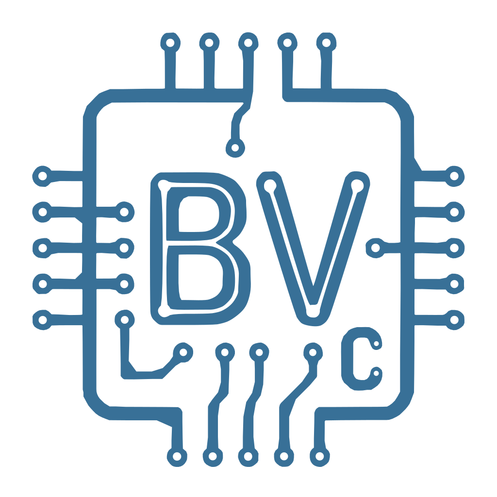
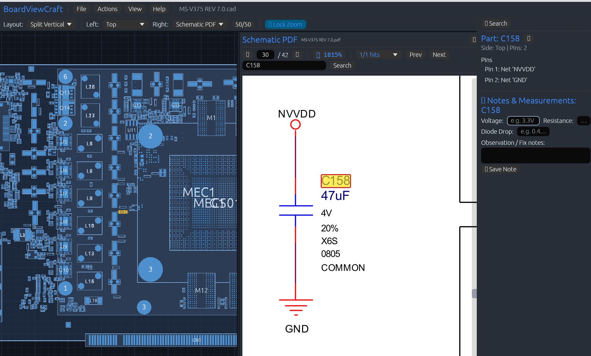

# BoardViewCraft

> High-performance, modern, pure Rust viewer for hardware repair and PCB inspection.

BoardViewCraft is an open-source boardview and schematic inspection workbench built from the ground up with **Rust**, **egui**, and hardware-accelerated **wgpu**. It provides ultra-fast navigation, clear component rendering, real pad geometries, camera overlay photo alignment, and native dual-pane split inspection with PDF and vector CAD schematics.



---

## Features

- **Fast Canvas**: Parallel spatial grid queries (`Rayon`) and hardware-accelerated tessellation (`Lyon`). Cached geometry meshes are re-mapped during pan/zoom for 60+ FPS navigation on dense PCBs with tens of thousands of pins and vias.
- **Flexible Layouts & Dual-Pane Split View**:
  - **Single Pane**, **Split Vertical** (side by side), or **Split Horizontal** (stacked).
  - Any pane can display **Top**, **Bottom**, **Both** (top and bottom with synchronized or independent view), **PDF Schematic**, or **CAD Schematic**.
  - Interactive resizable divider with reset shortcut.
- **Readable Board Rendering**: Filled part bodies, component outlines, pin names, and physical pad geometries (round, rectangular, rotated) read from GenCAD `$PADS` and CAD records.
- **Bijective Coordinates**: Pan, zoom, flip (TOP/BOTTOM), rotate (90° / 180°), and horizontal/vertical mirror with consistent coordinate mapping.
- **Advanced Search**:
  - Filter parts and nets with full wildcard matching (`*`, `?`), prefix chips (`U`, `R`, `C`, `Q`, `D`, `L`, `F`, `J`), comma-separated OR queries, and side filters (Top, Bottom, All).
- **Schematic PDF Viewer**:
  - Tiled multi-threaded rendering of zoomed pages, background text indexing, and vertical scrubber slider with preview badge for instant page jumping.
  - Bidirectional cross-probing: clicking a part or net on the board navigates to the schematic, and clicking references in the PDF navigates and centers the PCB.
  - Wheel scrolling for clean page turning and `Ctrl + Wheel` / pinch for precision zooming.
- **Vector CAD Schematics**:
  - Native vector parsing and rendering for KiCad (`.kicad_sch`) and Eagle (`.sch`) files.
  - Sheet switching, symbol graphics, net label inspection, and cross-probing.
- **Technician Notes & Measurements**:
  - Attach structured inspection notes and physical test readings (voltage, resistance, diode drop) to individual components or specific pins.
  - Visual `📝` badges in virtualized pin lists for quick test point identification.
  - Export full service inspection reports and complete Bill of Materials (BOM) in TSV.
- **Camera Overlays**:
  - Load real PCB inspection photos over Top and Bottom views.
  - Interactive multi-point pin alignment with opacity blending.
- **Independent Theming**:
  - Application UI (Light/Dark) and PCB themes (Light, Dark, Warm, Sweet Cold, Cadcraft, and Custom with customizable color tokens).
- **Extensive Format Support**:
  - GenCAD (`.cad`), TVW, KiCad (`.kicad_pcb`), Eagle (`.brd`), EasyEDA (Standard & Pro), Altium Designer (`.PcbDoc`), Allegro (`.brd`), Boardview (BRD/BRD2, BDV, BV2), ODB++, IPC-2581, and IPC-D-356.
- **Multilingual Support**: English, Spanish, Catalan, French, German, and Italian.

---

## Menus

| Menu | Entries |
| :--- | :--- |
| **File** | Open Board, Open Recent, Preferences, Close Board |
| **Actions** | Board actions and Adjust Overlay Photo |
| **View** | Zoom, show/hide Pins and Vias |
| **Help** | About (version and build information) |

---

## Quick Start

### Download

Prebuilt packages for Linux (AppImage, tar.gz, Flatpak), Windows, and macOS are published on the [Releases](https://github.com/elbuit/BoardViewCraft/releases) page.

### Prerequisites (building from source)
- [Rust toolchain](https://www.rust-lang.org/tools/install) (Rust 1.95+)

### Building and Running

```bash
# Clone the repository
git clone https://github.com/elbuit/BoardViewCraft.git
cd BoardViewCraft

# Run with Cargo
cargo run -p boardviewcraft --release
```

### Running Tests

```bash
cargo test --workspace --release
```

---

## Keyboard and Mouse

| Shortcut | Action |
| :--- | :--- |
| `F` | Auto-fit the visible board view(s) |
| `Space` | Switch between the Top and Bottom tabs |
| `R` | Rotate 90° Clockwise |
| `Shift + R` | Rotate 90° Counter-Clockwise |
| `M` | Mirror X (Horizontal) |
| `Shift + M` | Mirror Y (Vertical) |
| `Esc` | Clear selection / Reset flight lines |
| `Ctrl + ,` (`Cmd + ,` on macOS) | Open / close Preferences |
| `Scroll` | Zoom into cursor position (2.5× per wheel notch) |
| `Drag` | Pan canvas |
| Arrow keys / `+` / `-` | Pan / zoom the active board view (last hovered or clicked) |
| `Right Click` / `Ctrl + Click` | Context menu |
| `PageUp` / `PageDown`, `←` / `→` | Previous / next PDF page |
| `+` / `-` | Zoom PDF page |

Board shortcuts are ignored while a text field has focus or Preferences is open, and match their modifiers exactly (`R` does not fire on `Shift + R`).

The defaults above for fit, Top/Bottom switch, rotate, mirror, board pan/zoom (arrow keys, `+` / `=`, `-`) and Preferences can be rebound in **Preferences → Keyboard shortcuts** (click a shortcut, press the new key; `Esc` cancels). A key already used by another action is refused. `Esc` / `Enter` and the PDF tab keys stay fixed.

---

## Project Architecture

```
BoardViewCraft/
├── apps/
│   └── boardviewcraft/ # Application entry point
├── crates/
│   ├── bvc-core/       # Core geometry, board parsers, spatial grid, models
│   └── ui-egui/        # egui/wgpu canvas, PDF viewer, tessellator, themes, i18n, preferences
├── packaging/          # Linux, Windows, and macOS packaging scripts
└── assets/             # Fonts, icons, and test assets
```

---

## License

Licensed under either of:
- Apache License, Version 2.0 ([LICENSE-APACHE](LICENSE-APACHE) or http://www.apache.org/licenses/LICENSE-2.0)
- MIT license ([LICENSE-MIT](LICENSE-MIT) or http://opensource.org/licenses/MIT)

at your option.
