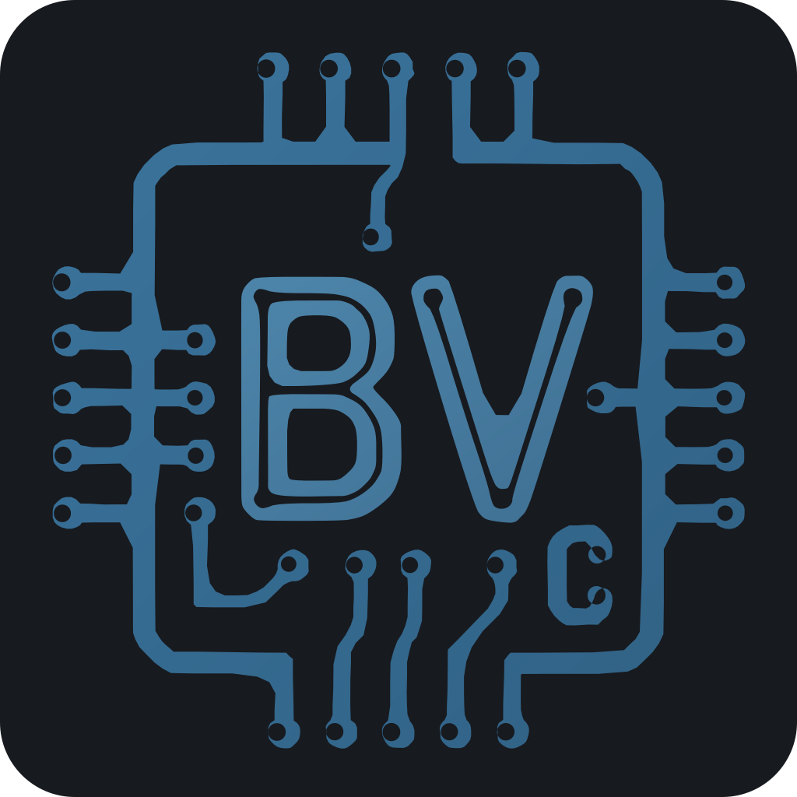

# BoardViewCraft app icon



A chip outline with PCB traces and vias around a "BV" monogram and a small "c", in blue on a
dark (`#14181b`) rounded tile. Source: the project owner's vector `BoardViewCraft_5B_exacto.svg`
(the master) and its background-less variant `BoardViewCraft_5B_transparente.svg` (the mark).

**Tile:** `viewBox="0 0 1024 1024"`, a rounded square with `rx=96`; the corners outside it are
transparent. Windows and Linux icons use the full-bleed tile. macOS icons put it on Apple's grid
(an 824 px body centred on a transparent 1024 px canvas).

## Files

| File | What it is |
|---|---|
| `boardviewcraft.svg` | the master vector; every PNG, `.ico` and `.icns` is rendered from it |
| `boardviewcraft-mark.svg` | the same drawing without the tile (transparent background), for documents such as the project README |
| `boardviewcraft-1024.png` | 1024 px on Apple's grid; also the runtime Dock icon on macOS |
| `boardviewcraft.icns` | macOS icon (16–1024 px, incl. @2x), copied into the `.app` by `packaging/macos/package.sh` |
| `boardviewcraft.ico` | Windows icon (16, 20, 24, 32, 40, 48, 64, 128, 256 px), embedded in `boardviewcraft.exe` by `apps/boardviewcraft/build.rs` and used by the MSI |
| `hicolor/<n>x<n>/apps/io.github.elbuit.BoardViewCraft.png` | Linux hicolor theme, 16–512 px; the 256 px one is the runtime icon on Windows and Linux |
| `hicolor/<n>x<n>/apps/boardviewcraft.png` | the same PNGs under the binary name (the AppImage step reads it) |
| `hicolor/scalable/apps/io.github.elbuit.BoardViewCraft.svg` | Linux scalable icon (copy of the master) |

Where it shows: `apps/boardviewcraft/src/main.rs` sets the window icon (Dock, taskbar, Alt-Tab,
launcher) and the Wayland app id `io.github.elbuit.BoardViewCraft`;
`packaging/linux/boardviewcraft.desktop` and the metainfo name the hicolor icon.

## Regenerate

```sh
packaging/icons.sh   # needs resvg (cargo install resvg --locked) and python3
```

The `.icns` is written by `iconutil` on macOS and by a small stdlib writer elsewhere, so the whole
set can be regenerated on Linux. The outputs are committed; building and packaging never need these
tools.
