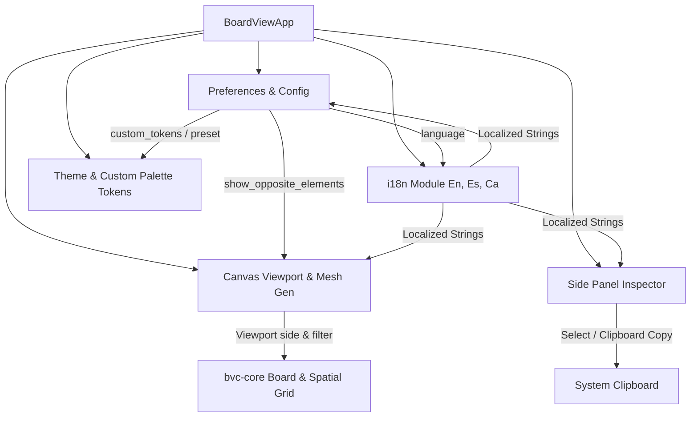

# Proposal: BoardViewCraft Layer Filtering, Selectable Panels, Extended Themes & i18n

- **Change Name:** `boardview-layer-filtering-i18n-themes`
- **Status:** Draft / Proposed
- **Author:** sdd-propose
- **Date:** 2026-10-23
- **Target Workspaces:** `BoardViewCraft` (`bvc-core`, `bvc-app`)
- **Reference Codebases:** `OpenBoardView`, `cadcraft`

---

## 1. Intent & Problem Statement

Technicians and hardware reverse engineering engineers using BoardViewCraft encounter several ergonomic and visualization pain points during motherboard repair and schematic tracing:

1. **Visual Clutter from Opposite-Side Elements:**
   - When inspecting the TOP layer of a dense motherboard (such as graphics cards or complex laptops), pins and vias from the BOTTOM layer are rendered dimmed or in dark colors (`tokens.via_opp_side`, opposite side net highlights, etc.). On dense high-density boards, this clutters the viewport and makes it difficult to distinguish whether a solder pad or test point is physically accessible on the current side or buried on the reverse side.
   - Users need **Strict Layer Filtering**: when viewing TOP, only show pins, vias, parts, and text labels that are on TOP (or Through-Hole / Both). Opposite-side elements must be hidden completely, with an optional toggle in preferences (`show_opposite_elements: bool`, default `false`) for users who explicitly want dual-layer projection.
2. **Non-Selectable / Non-Copyable Side Panel Data:**
   - In the Side Inspection panel (Net Details, Part Details, Search tabs), values such as Net names, Part designators, pin coordinates, and pin counts are currently rendered as static read-only labels or selectable buttons that immediately change selection without allowing standard OS text selection or clipboard copying.
   - Users frequently need to copy net names (e.g. `PP3V3_G3H`, `GPU_CORE_PWM`) or coordinates to cross-reference with PDF schematics, boardview notes, or repair tickets.
3. **Hardcoded / Limited Theme Customization:**
   - While BoardViewCraft provides predefined themes (`Tokens::DARK`, `Tokens::OBV`, `Tokens::HIGH_CONTRAST`, `Tokens::LIGHT`), users cannot tweak individual colors (e.g. customized canvas background, custom pin highlights, net web color, or board outline).
   - Repair shops often have customized probe setups, specific monitor calibrations, or accessibility needs requiring granular color picker control and the ability to save/load custom theme presets.
4. **Lack of Internationalization (i18n):**
   - The entire user interface (menus, preferences dialog, inspector tabs, status bar) is hardcoded in English.
   - Board repair technicians worldwide require multi-language support, specifically **English (en)**, **Spanish (es / Español)**, and **Catalan (ca / Català)**, with instant switching via Preferences and menu selectors.

---

## 2. Scope

### In Scope
- **Strict Layer Filtering (bvc-app & bvc-core):**
  - Add preference `show_opposite_elements: bool` (default `false`) in `Preferences`.
  - In `canvas::generate_board_meshes`:
    - Vias: If `!show_opposite_elements`, strictly filter vias where `!via.side.visible_on(vp.side)`.
    - Pins: If `!show_opposite_elements`, strictly filter pins where `!pin.side.visible_on(vp.side)`.
    - Component outlines: Strictly hide components where `!part.side.visible_on(vp.side)`.
    - Component text labels: Ensure part designator labels are strictly hidden if not visible on the active view side.
    - Hit testing (`Board::find_pin_near`, `Board::find_via_near`): Respect active view side and layer filtering so hovering/clicking opposite side elements does not trigger unless opposite side display is enabled.
- **Selectable & Copyable Side Panel (bvc-app):**
  - Make net names, part designators, and coordinate strings easily selectable and copyable across Net Details, Part Details, and Search tabs.
  - Integrate clipboard copy actions (using `ui.output_mut(|o| o.copied_text = ...)` or copy icon buttons `📋`) for:
    - Net name and pin/via summary in Net Details.
    - Component name and pin details in Part Details.
    - Search result items.
  - Support context menu (right-click -> "Copy Name", "Copy Coordinates", "Copy Pin List").
- **Customizable Colors & Extended Theme System (bvc-app):**
  - Extend `Tokens` and `Preferences` to support custom color overrides or a `ThemePreset::Custom` variant.
  - Color pickers in Preferences dialog for:
    - Canvas background (`canvas`)
    - Board outline (`board_outline`) and board fill (`board_fill`)
    - Pins default (`pin_default`), pins highlight (`pin_highlight_cur_side`, `pin_highlight_opp_side`), unconnected pins (`pin_unconnected`)
    - Vias (`via_cur_side`, `via_opp_side`, `via_highlight`)
    - Net web / ratlines (`net_web`)
    - Part text labels (`part_text`)
    - Hover (`hover`) and Selection (`selection`)
  - Preset management: Ability to load base presets (Cadcraft Dark, OpenBoardView, High Contrast, Light) and save/restore customized color palettes in JSON/RON user settings.
- **Multi-language Support (i18n) (bvc-app):**
  - Create a clean zero-dependency localization module `i18n.rs` with `Language` enum (`En`, `Es`, `Ca`).
  - Keyed string lookup system `tr(key, lang)` or `t!(key, lang)` covering:
    - Window title, menu actions (File, View, Preferences, Flip Side, Rotate, Fit).
    - Status bar indicators (Side, Scale, Coordinates, Parts/Pins loaded).
    - Preferences dialog headings, labels, tooltips, checkboxes.
    - Side panel tabs ("Net Details", "Part Details", "Search / List") and placeholder texts.
  - Preference persistence of the selected language and language switcher in Preferences and View menu.

### Out of Scope
- Dynamic runtime downloading of external gettext/PO catalog files over network (compiled-in string dictionary is sufficient and robust).
- Bi-directional text layout (RTL) for Arabic/Hebrew (only Latin scripts En, Es, Ca are required in this phase).
- Modifying underlying binary CAD parser formats (`.cad`, `.fz`, `.brd`).

---

## 3. Capabilities & User Experience

### 3.1 Strict Layer Filtering Workflow
- When the user launches BoardViewCraft and loads a motherboard:
  - Top side active: Only Top surface-mount parts, Top pads, and Through-Hole vias/pins appear. No ghosted or dimmed bottom elements clutter the view.
  - Flipping side (`Space` or View -> Flip Side): The canvas cleanly transitions to Bottom layer elements; all Top-exclusive parts and pins disappear.
  - In Preferences -> Visualization: User can toggle `Show Opposite Side Elements` if they specifically want x-ray inspection mode.

### 3.2 Side Panel Copy & Selection Workflow
- When a net or part is selected:
  - An inline copy button (`📋`) appears next to the Net title and Part designator.
  - Clicking `📋` or right-clicking on any pin entry copies its designator and coordinates to the OS clipboard, triggering a brief toast/status bar notification (`"Copied 'PP3V3_G3H' to clipboard"`).
  - Net summary and pin lists allow text drag selection for quick copy-pasting into chat, schematics, or terminal.

### 3.3 Theme Customization Workflow
- In Preferences -> Color Scheme:
  - User can select any preset (Cadcraft Dark, OBV Classic, High Contrast, Light) or choose "Custom".
  - A collapsible "Custom Palette" section displays color pickers (`ui.color_edit_button_srgba`) for all critical boardview primitives.
  - A "Reset to Preset" button restores defaults.
  - Custom colors are serialized in `Preferences` config.

### 3.4 Multi-Language Experience
- In Preferences -> General / Language (or top-level Menu):
  - User selects `English`, `Español`, or `Català`.
  - UI labels immediately refresh across the toolbar, side panel, canvas status indicators, and modal dialogues without requiring application restart.

---

## 4. Technical Architecture & Approach

### 4.1 Component Architecture Diagram



### 4.2 Data Models & Signatures

#### A. Layer Filtering in `Preferences` & `Canvas`
```rust
// bvc-app/src/preferences.rs
#[derive(Clone, Debug, PartialEq, Serialize, Deserialize)]
pub struct Preferences {
    pub theme: ThemePreset,
    pub custom_tokens: Option<Tokens>,
    pub show_opposite_elements: bool, // Default: false (strict layer filtering)
    pub show_net_web: bool,
    pub show_part_labels: bool,
    pub show_pin_annotations: bool,
    pub high_density_lod: bool,
    pub language: Language,            // Default: Language::En
}
```

In `canvas::generate_board_meshes`:
```rust
// Filter vias:
let is_on_cur_side = via.side.visible_on(vp.side);
if !show_opposite_elements && !is_on_cur_side {
    return (normal_mesh, hl_mesh); // Skip opposite side completely
}

// Filter pins:
let is_on_cur_side = pin.side.visible_on(vp.side);
if !show_opposite_elements && !is_on_cur_side {
    return (normal_mesh, hl_mesh); // Skip opposite side completely
}
```

In `canvas::CanvasViewKey`:
Include `show_opposite_elements` in the view cache key so toggling this preference correctly invalidates cached geometry.

#### B. Internationalization (`i18n.rs`)
```rust
#[derive(Clone, Copy, Debug, PartialEq, Eq, Serialize, Deserialize)]
pub enum Language {
    En,
    Es,
    Ca,
}

impl Language {
    pub const ALL: [Language; 3] = [Language::En, Language::Es, Language::Ca];
    pub fn display_name(self) -> &'static str {
        match self {
            Language::En => "English",
            Language::Es => "Español",
            Language::Ca => "Català",
        }
    }
}

pub fn tr(key: &str, lang: Language) -> &'static str {
    // Compile-time or static dictionary mapping keys to strings in En, Es, Ca
}
```

#### C. Selectable Side Panel & Clipboard
In `side_panel.rs`:
- Use `egui::TextEdit::singleline(&mut text).interactive(false)` or `Label::new(text).selectable(true)` for net names and pin details.
- Provide a helper `copy_button(ui, text, tooltip)` using `ui.ctx().copy_text(text.to_string())` or `ui.output_mut(|o| o.copied_text = text.to_string())`.
- Add right-click context menu on pin / net entries with `"Copy Name"`, `"Copy Coordinates"`, `"Copy Line"`.

#### D. Theme Customization & Color Tokens
In `theme.rs`:
- Ensure `Tokens` derives `Serialize, Deserialize, Clone, PartialEq`.
- Provide `ThemePreset::Custom` and helper to clone tokens from active preset into mutable preferences tokens.
- Add palette UI editor in `preferences.rs` with swatch buttons and reset option.

---

## 5. Affected Areas & Files

| Component / File | Changes |
| :--- | :--- |
| `BoardViewCraft/crates/bvc-app/src/preferences.rs` | Add `show_opposite_elements`, `language`, and `custom_tokens` to `Preferences`. Add color picker section and language dropdown to Preferences dialog. |
| `BoardViewCraft/crates/bvc-app/src/theme.rs` | Add `Serialize, Deserialize` to `Tokens`. Add `ThemePreset::Custom`. Add preset cloning/override utilities. |
| `BoardViewCraft/crates/bvc-app/src/canvas.rs` | Enforce strict layer filtering in `generate_board_meshes` (vias, pins, component labels, outlines) when `!show_opposite_elements`. Include flag in `CanvasViewKey`. |
| `BoardViewCraft/crates/bvc-app/src/side_panel.rs` | Convert read-only labels to selectable text or add copy buttons (`📋`) and context menus in Net, Part, and Search tabs. Support localized labels via `i18n`. |
| `BoardViewCraft/crates/bvc-app/src/i18n.rs` (New) | Implement `Language` enum and `tr(key, lang)` localization catalog for English, Spanish, and Catalan. |
| `BoardViewCraft/crates/bvc-app/src/main.rs` | Integrate `i18n` in menu bars, status bars, and dialogs. Handle clipboard toast notifications. |
| `BoardViewCraft/crates/bvc-core/src/board.rs` | Ensure hit-testing methods (`find_pin_near`, `find_via_near`) respect layer visibility conditions if specified. |

---

## 6. Risks & Mitigations

| Risk | Impact | Mitigation |
| :--- | :--- | :--- |
| Incomplete translation keys | Low | Fallback to English (`Language::En`) for any missing key in `tr()`. Unit test verifying all dictionary keys exist in En, Es, and Ca. |
| Mesh cache invalidation bugs | Medium | Ensure `show_opposite_elements` and active `Tokens` hash/eq are captured in `CanvasViewKey` so switching layer filtering or themes immediately refreshes the canvas. |
| egui version clipboard compatibility | Low | Use standard `ctx.copy_text(...)` / `ui.output_mut(|o| o.copied_text = ...)` supported across egui versions without extra native dependencies. |
| Performance overhead from text selection | Low | Side panel items are only rendered for visible scrolled rows; `TextEdit::multiline` or `selectable_label` has negligible overhead for inspector panels. |

---

## 7. Rollback Plan

If layer filtering or custom theme changes introduce regressions:
1. Reverting the changes in `canvas.rs` restores the previous dual-layer rendering behavior.
2. The `Preferences` struct can safely fall back to default presets without invalidating stored configs.
3. The codebase remains modular with `i18n` encapsulated in `bvc-app/src/i18n.rs`.

---

## 8. Dependencies

- No external crate dependencies are required. All features are implemented using standard `egui`, `serde`, and `bvc-core` primitives.

---

## 9. Success Criteria

1. **Strict Layer Filtering:**
   - On TOP view with `show_opposite_elements == false`, zero pins or vias with `Side::Bottom` are drawn or hit-tested.
   - On BOTTOM view with `show_opposite_elements == false`, zero pins or vias with `Side::Top` are drawn or hit-tested.
   - Through-Hole (`Side::Both`) pins and vias remain visible on both sides.
   - Toggling `Show Opposite Side Elements` in preferences immediately reveals dimmed opposite elements.
2. **Selectable & Copyable Side Panel:**
   - Net names, part designators, and pin coordinate lists can be copied to system clipboard via click or context menu.
   - Text can be highlighted and copied via standard keyboard shortcut (`Ctrl+C`).
3. **Custom Colors & Themes:**
   - Users can customize pin, via, canvas, net web, and outline colors in Preferences.
   - Presets can be loaded and modified without crashing.
4. **i18n Multi-language:**
   - Switching language to Spanish or Catalan updates all UI headers, menus, tabs, and preference labels.
   - All translation keys are covered with 100% test verification across En, Es, and Ca.
