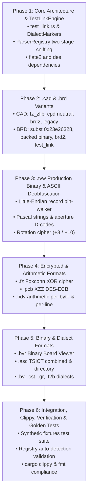

# Proposal: Comprehensive Multi-Format Boardview Support (`boardview-multi-format-support`)

- **Change Name**: `boardview-multi-format-support`
- **Status**: Proposed
- **Date**: 2026-10-23
- **Target Projects**: `BoardViewCraft` (`crates/bvc-core`, `crates/bvc-app`)
- **Mode**: Hybrid (OpenSpec + Engram)
- **Reference Codebases**: `wrench-board/FORMATS.md`, `wrench-board/api/board/parser/`, `wrench-board/rust/` (`wb_tvw_walker`, `wb_fz_cipher`), `OpenBoardView/src/openboardview/FileFormats/`

---

## 1. Context & Problem Statement

[`BoardViewCraft`](file:///media/no_raid/devel/boarview/BoardViewCraft) is a clean-room, high-performance Rust boardview viewer. Currently, its core parsing engine (`crates/bvc-core/src/parser/`) supports only two formats:
1. **GenCAD 1.4** (`.cad` / `$HEADER GENCAD` tokens).
2. **Classic ASCII CAD / Test_Link** (`.cad` / `###Panel Added`, `COMP`, `C_PIN`, `NET`).

In practical electronics diagnostics, laptop/phone board repair, and industrial hardware reverse engineering, files arrive in a wide array of legacy, vendor-proprietary, and obfuscated formats. The exact specifications, reverse-engineered grammars, and reference implementations for these formats are thoroughly documented in [`wrench-board/FORMATS.md`](file:///media/no_raid/devel/boarview/wrench-board/FORMATS.md) and [`OpenBoardView/src/openboardview/FileFormats/`](file:///media/no_raid/devel/boarview/OpenBoardView/src/openboardview/FileFormats/).

To achieve full feature parity with industry-standard viewers, `bvc-core::parser` must be expanded to parse all major boardview formats safely, robustly, and with zero panics.

---

## 2. Goals & Non-Goals

### Goals
- **Full Format Coverage**: Implement parsers in `bvc-core` for:
  - **`.cad` Variants**: FZ zlib-compressed (`looks_like_fz_zlib`), CPD neutral file format (`# CPD`), BRD2 dialect (`BRDOUT:`), and legacy fallback.
  - **`.tvw` (TestView / Teleplan)**: Binary production container (Port of `wb_tvw_walker` Little-Endian record parser, Pascal strings, aperture D-codes) and ASCII variant with rotation cipher deobfuscation (+3 digits, +10 letters).
  - **`.brd` Variants (Auto-sniffing)**: Automatic byte-level sniffing between substitution-encoded (`\x23\xe2\x63\x28`), packed binary heap (`_PACKED_BRD_MAGICS`), BRD2 (`BRDOUT:`), and classic Test_Link (`str_length:`).
  - **Additional Formats**:
    - `.fz`: Foxconn XOR-scrambled (port of `wb_fz_cipher` RC6-like 16-byte sliding window cipher) + FZ-zlib container.
    - `.pcb`: XZZ encrypted container (XOR descrambling + DES-ECB block decryption of PART blocks).
    - `.bdv`: Arithmetic deobfuscation (both per-byte synthetic and per-line field schedules with 285 &rarr; 159 wrap).
    - `.asc`: TSICT CAD (combined single-file and multi-file directory synthesis).
    - `.bv`: ATE BoardView (ASCII Test_Link shape + JET4 Microsoft Access binary detection).
    - `.bvr`: Binary Board Viewer (compact Little-Endian binary format points, parts, pins, nails).
    - `.cst`: Compal CST format (bracketed section markers `[Format]`, `[Components]`, `[Pins]`, `[Nails]`).
    - `.gr`: BoardView R5.0 GR format (Test_Link shape with `BRDOUT:` delegation).
    - `.f2b`: F2B board-save format (Test_Link shape with `Outline:` / `Components:`).
- **Unified Engine for Test_Link-Shaped Dialects**: Implement a generic, reusable `TestLinkEngine` configured via `DialectMarkers` to eliminate code duplication across ASCII variants (.bv, .gr, .cst, .f2b, .asc, .cad, .tvw deobfuscated, .bdv fixture).
- **Content-Based Sniffing & Two-Stage Registry**: Upgrade `ParserRegistry` to prioritize magic-number sniffing (resolving ambiguous extensions like `.cad` and `.brd`) before falling back to extension lookup.
- **Strict Safe Rust**: Enforce `#![forbid(unsafe_code)]`, zero panics, no `.unwrap()`/`.expect()` in parsing routines, and returning detailed `Result<Board, ParseError>`.

### Non-Goals
- **External CLI Tool Wrappers**: No sub-process execution (e.g. KiCad `pcbnew` Python scripts). KiCad native parsing will be handled separately if needed.
- **Modifying the Core Board Model**: Use the existing canonical [`bvc_core::Board`](file:///media/no_raid/devel/boarview/BoardViewCraft/crates/bvc-core/src/board.rs) and [`model`](file:///media/no_raid/devel/boarview/BoardViewCraft/crates/bvc-core/src/model.rs) entities (`Part`, `Pin`, `Net`, `Via`, `Point`, `Rect`, `Side`) without breaking existing renderer contracts.

---

## 3. Architecture & Module Design

### 3.1 Proposed Directory Structure in `bvc-core`

```text
crates/bvc-core/src/parser/
├── mod.rs                   // FormatParser trait, ParseError enum, byte sniff helpers
├── registry.rs              // Two-stage ParserRegistry (content-sniffing + extension fallback)
├── test_link.rs             // Unified Test_Link-shape engine (DialectMarkers, power/ground regex)
├── cad/
│   ├── mod.rs               // Umbrella CAD dispatcher (fz_zlib -> cpd -> brd2 -> gencad -> legacy)
│   ├── cpd.rs               // CPD neutral format (# CPD, COMP, C_PIN, NET)
│   └── fz_zlib.rs           // FZ zlib-compressed pipe-delimited payload
├── tvw/
│   ├── mod.rs               // TVW dispatcher (binary production vs ASCII rotation cipher)
│   ├── binary.rs            // Production binary TVW parser (clean-room port of wb_tvw_walker)
│   └── deobfuscate.rs       // ASCII symmetric rotation cipher (+3 digits, +10 letters)
├── brd/
│   ├── mod.rs               // .brd sniffer (magic checks -> subst / packed / brd2 / test_link)
│   ├── subst.rs             // Substitution-encoded BRD (0x23 0xe2 0x63 0x28 bitwise rotate/invert)
│   ├── packed.rs            // Packed binary heap parser (0a0a1200, 030c1300, etc.)
│   ├── brd2.rs              // BRD2 format (BRDOUT:, uppercase blocks, cumulative pin indices)
│   └── ascii.rs             // Canonical Test_Link ASCII parser (str_length:, var_data:)
├── fz.rs                    // Foxconn XOR-scrambled cipher (clean-room port of wb_fz_cipher)
├── pcb.rs                   // XZZ encrypted .pcb (XOR stream descrambler + DES-ECB block cipher)
├── bdv.rs                   // Arithmetic-encoded BDV (per-byte and per-line schedules)
├── asc.rs                   // TSICT .asc parser (combined file & multi-file directory synthesis)
├── bv.rs                    // ATE BoardView .bv (ASCII dialect + JET4 binary detection)
├── bvr.rs                   // Binary Board Viewer .bvr (BVR\0 binary Little-Endian layout)
├── cst.rs                   // Compal CST ([Format], [Components], [Pins], [Nails])
├── gr.rs                    // BoardView R5.0 GR (BRDOUT: fallback + Test_Link dialect)
└── f2b.rs                   // F2B board-save (Outline:, Components:, Pins:, Nails:)
```

### 3.2 Two-Stage Parser Dispatch Pipeline

```text
Incoming File (filename, data)
               │
               ▼
┌───────────────────────────────────────────────┐
│ Stage 1: Content Sniffing (Magic / Signatures) │
├───────────────────────────────────────────────┤
│ • 0x23 0xe2 0x63 0x28       → BRD Subst       │
│ • Packed BRD Magics (4-byte)→ BRD Packed      │
│ • "BRDOUT:"                 → BRD2            │
│ • "str_length:"             → Test_Link BRD   │
│ • Offset 4 zlib magic       → CAD / FZ Zlib   │
│ • "# CPD" / "###Board Info" → CPD Neutral     │
│ • "$HEADER" & "GENCAD"      → GenCAD          │
│ • "BVR\0"                   → BVR             │
│ • TVW Binary Magic (Vendor) → TVW Binary      │
│ • "dd:1.3?,r?-=bb"          → BDV             │
│ • JET4 Magic (00 01 00 00)  → BV JET4 detect  │
└───────────────────────┬───────────────────────┘
                        │ (No confident magic match)
                        ▼
┌───────────────────────────────────────────────┐
│ Stage 2: Extension Dispatch & Validation      │
├───────────────────────────────────────────────┤
│ • .cad  → Umbrella CadParser (heuristic test) │
│ • .tvw  → TVWParser (Binary vs Rot-Cipher)    │
│ • .brd  → BrdSniffParser                      │
│ • .fz   → FZParser (XOR cipher / Zlib)        │
│ • .pcb  → XZZParser                           │
│ • .bdv  → BDVParser                           │
│ • .asc  → ASCParser                           │
│ • .bv   → BVParser                            │
│ • .bvr  → BVRParser                           │
│ • .cst  → CSTParser                           │
│ • .gr   → GRParser                            │
│ • .f2b  → F2BParser                           │
└───────────────────────────────────────────────┘
```

---

## 4. Format Specifications & Technical Details

### 4.1 `.cad` Umbrella Variants
1. **FZ zlib-compressed (`fz_zlib.rs`)**:
   - Signature: First 4 bytes indicate uncompressed size as Little-Endian `u32`. Bytes 4..6 contain zlib magic (`0x78 0x9c`, `0x78 0x01`, or `0x78 0xda`).
   - Decoding: Decompress zlib stream using `flate2::read::ZlibDecoder`.
   - Grammar: Pipe-delimited (`!`) text with schemas (`A!col1!col2!...`) and data (`S!val1!val2!...`). Parse parts, pins, nets, and outline. Normalize mm to mils if unit is mm (`_MILS_PER_MM = 39.3700787`).
2. **CPD Neutral File (`cpd.rs`)**:
   - Signature: `# CPD` header comments or `###Board Information` / `###Component Information`.
   - Grammar: Sectioned by `###`. `COMP <refdes> ... <x> <y> <side>`, `C_PIN <refdes>-<pin> <x> <y> ... <net>`, `NET <netname>`, `N_VIA <x> <y> ...`.
   - Normalization: Coordinates in Inches or Mm. converted to mils.
3. **BRD2 Dialect (`brd2.rs`)**:
   - Signature: Contains `BRDOUT:`. Routed to `BRD2Parser`.

### 4.2 `.tvw` (TestView / Teleplan)
1. **Binary Production TVW (`tvw/binary.rs`)**:
   - Reference: [`wrench-board/rust/wb_tvw_walker/src/lib.rs`](file:///media/no_raid/devel/boarview/wrench-board/rust/wb_tvw_walker/src/lib.rs) and `_tvw_engine/`.
   - Magic: Production signatures (Vendor A / Vendor B `\x13\x4f\x39\x35`, V3.0 / V4.0).
   - Grammar: Little-Endian records, Pascal-length-prefixed strings, aperture D-code tables, component & net tables, zero-copy record pin-walk.
2. **ASCII TVW Rotation Cipher (`tvw/deobfuscate.rs`)**:
   - Deobfuscation: Symmetric character rotation:
     - Digits `0-9`: `(c - '0' - 3 + 10) % 10 + '0'`.
     - Lowercase `a-z`: `(c - 'a' - 10 + 26) % 26 + 'a'`.
     - Uppercase `A-Z`: `(c - 'A' - 10 + 26) % 26 + 'A'`.
     - Other characters unchanged.
   - Delegation: Decoded text is passed to `TestLinkEngine`.

### 4.3 `.brd` Auto-Sniffing
1. **Substitution-Encoded BRD (`brd/subst.rs`)**:
   - Magic: `\x23\xe2\x63\x28`.
   - Decoding: Closed-form bitwise transformation:
     ```rust
     let decoded = data.iter().map(|&b| {
         if b == b'\r' || b == b'\n' || b == 0 {
             b
         } else {
             !(((b >> 6) & 3) | (b << 2))
         }
     }).collect::<Vec<u8>>();
     ```
   - Decodes to standard `str_length:` Test_Link shape.
2. **Packed Binary BRD (`brd/packed.rs`)**:
   - Magic: 4-byte prefixes (`0a0a1200`, `030c1300`, `03101300`, `060b1200`, `0c0f1200`, `04151300`) and watermark `MASTER_DESIGN`.
   - Parsing: String heap at `0x1200`, placed component refdes records (`CRLUDQJKPYXFTBVZHGSEMNW` classes), net names.
3. **BRD2 (`brd/brd2.rs`)**:
   - Header `BRDOUT:`, uppercase sections (`NETS:`, `PARTS:`, `PINS:`, `NAILS:`).
   - Derives pin ownership via cumulative `first_pin` indices.
4. **Test_Link ASCII (`brd/ascii.rs`)**:
   - Headers `str_length:`, `var_data:`. Standard 4-count header + Format, Parts, Pins, Nails.

### 4.4 Additional Formats
1. **`.fz` (Foxconn JetEngine / XOR Scrambled)**:
   - Reference: [`wrench-board/rust/wb_fz_cipher/src/lib.rs`](file:///media/no_raid/devel/boarview/wrench-board/rust/wb_fz_cipher/src/lib.rs).
   - RC6-like 16-byte sliding window cipher with 44×32-bit key schedule, yielding plaintext pipe-delimited or Test_Link payload. If no external key is provided, falls back to built-in vendor key tables or detects FZ-zlib container.
2. **`.pcb` (XZZ Encrypted)**:
   - Reference: `wrench-board/api/board/parser/xzz.py`.
   - Header checks, XOR byte descrambler, DES-ECB decryption of encrypted `PART` blocks using DES keys. Extract parts, pins, nets, vias, arcs, and outlines.
3. **`.bdv` (Arithmetic Deobfuscation)**:
   - Schedule 1 (Per-byte): Key starts at 160, increments by 1 per non-newline byte, wraps 285 &rarr; 159. `clear = (key - b) & 0xFF`.
   - Schedule 2 (Per-line, field shape `dd:`): Key increments once per `\n`. Decoded text parsed via fixture dialect or `TestLinkEngine`.
4. **`.asc` (TSICT)**:
   - Combined single-file (contains `Format:`, `Parts:`, `Pins:`, `Nails:`) or multi-file directory discovery (`format.asc`, `parts.asc`, `pins.asc`, `nails.asc`).
5. **`.bv` (ATE BoardView)**:
   - Binary check: detects JET4 MS Access database (`00 01 00 00` + `"Standard Jet DB"`).
   - ASCII check: parsed via `TestLinkEngine`.
6. **`.bvr` (Binary Board Viewer)**:
   - Magic `BVR\0`, Little-Endian `u32` counts for format points, parts, pins, nails, with explicit byte-length strings and side bitmasks.
7. **`.cst`, `.gr`, `.f2b`**:
   - Configured through `TestLinkMarkers` with custom block markers (`[Format]`, `[Components]`, `TestPoints:`, `Outline:`, `Annotations:`).

---

## 5. Crate Dependencies & Safe Rust Guarantees

To support decompression and cryptographic descrambling without compromising security or portability:
- **`flate2 = "1.0"`** (pure-Rust `miniz_oxide` backend) for FZ-zlib inflation.
- **`des = "0.8"`** & **`cipher = "0.4"`** (pure-Rust RustCrypto) for XZZ `.pcb` DES-ECB decryption.
- **`#![forbid(unsafe_code)]`**: Strictly maintained across all new parser modules.
- **Zero-Panic Policy**: No `.unwrap()`, no `.expect()`, no slicing without bounds checks. All invalid inputs return `Err(ParseError::SyntaxError { .. })` or `Err(ParseError::UnrecognizedFormat(..))`.

---

## 6. Implementation Phases



---

## 7. Risks & Rollback Plan

### Identified Risks
1. **Ambiguous Extension Collisions**: `.cad` and `.brd` files can represent completely different formats.
   - *Mitigation*: Two-stage registry where fast signature and magic-byte checks run before extension fallbacks.
2. **Malformed or Hostile Input (Denial of Service)**: Truncated binary files, recursive zlib bombs, or huge heap offsets.
   - *Mitigation*: Strict checked offsets (`checked_add`), max allocation limits on heap parsing, and wrapping arithmetic in decoders.
3. **Performance Overhead on Large Files**: Walking hundreds of thousands of pins in large production `.tvw` or `.cad` files.
   - *Mitigation*: Zero-copy slice borrowing (`&[u8]`) throughout parsers, pre-allocating vectors based on verified header counts.

### Rollback Plan
- Each parser module is strictly independent and registers through `ParserRegistry`.
- If a specific parser encounters an edge-case regression in production, its registration in `ParserRegistry::default()` can be disabled without affecting other formats or the viewer application.
- The existing `GenCadParser` and legacy `CadParser` logic remains fully intact and verified by regression tests.

---

## 8. Verification & Testing Strategy

- **Unit Tests with Synthetic Fixtures**: Each parser module will contain dedicated unit tests covering:
  - Valid minimal board sample parsing (outline, parts, pins, nets, vias).
  - Malformed header and corrupt payload rejection (ensuring graceful `Err(ParseError)`).
  - Deobfuscation round-trip and decoding verification.
- **Backwards Compatibility**: Existing `SAMPLE_GENCAD` and `SAMPLE_CAD` tests in `lib.rs` must pass without modification.
- **Cargo Validation**:
  - `cargo test --workspace` must pass with zero failures.
  - `cargo clippy --workspace --all-targets` must pass cleanly without warnings.
  - `cargo fmt --check` must confirm formatting compliance.
