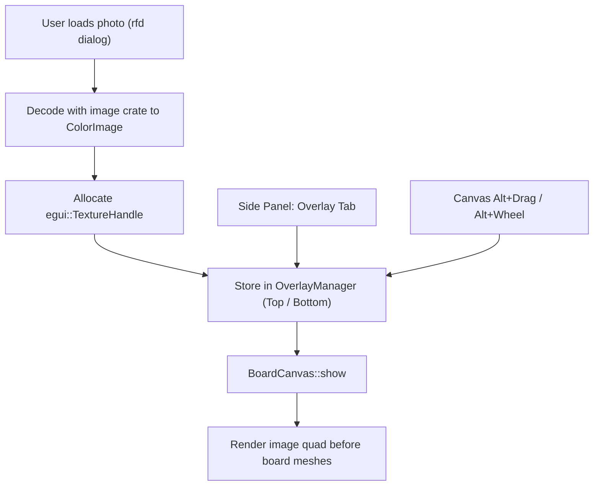

# Design: PCB Background Image Overlay

## Architecture Overview



## Detailed Components

### 1. `OverlaySlot` and `OverlayManager` (`crates/bvc-app/src/overlay.rs`)
```rust
pub struct OverlaySlot {
    pub file_path: Option<PathBuf>,
    pub texture: Option<egui::TextureHandle>,
    pub orig_dimensions: (u32, u32),
    pub center: Point,
    pub size: egui::Vec2,
    pub aspect_locked: bool,
    pub opacity: f32,
    pub fine_rotation_deg: f32,
    pub locked: bool,
    pub visible: bool,
}

pub struct OverlayManager {
    pub top: OverlaySlot,
    pub bottom: OverlaySlot,
}
```

### 2. Canvas Geometry & Projection
In `canvas.rs`, before emitting the cached or newly tessellated board meshes, calculate the 4 transformed corners of the overlay quad in world space:
- Center: `slot.center`
- Size: `slot.size.x`, `slot.size.y`
- Local rotation: `slot.fine_rotation_deg`
- Screen transform: `vp.world_to_screen(...)`

Tessellate as a 2-triangle textured `egui::Mesh` with UV coordinates `(0,0)`, `(1,0)`, `(1,1)`, `(0,1)` and vertex color `Color32::from_white_alpha((slot.opacity * 255.0) as u8)`.

### 3. Side Panel Tab
Add `Tab::Overlay` to `SidePanelState` and implement `show_overlay_controls(...)`.

### 4. Interactive Keyboard/Mouse Handling
In `canvas.rs`, check for `ui.input(|i| i.modifiers.alt)`:
- If Alt is held and mouse is dragged on canvas, update `active_slot.center` by the mouse pan delta in world units.
- If Alt is held and mouse wheel is scrolled, scale `active_slot.size` proportionately.
