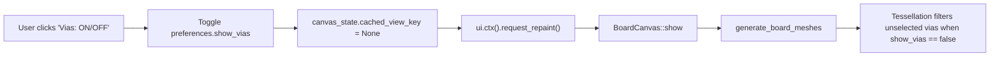

# Design: Toolbar Via Visibility Toggle

## Architecture Overview

`Preferences::show_vias` already controls via visibility in `BoardCanvas::show` and `generate_board_meshes`. The top toolbar in `crates/bvc-app/src/main.rs` requires an egui button to toggle this preference and invalidate the view cache key.



## Detailed Changes

1. **`crates/bvc-app/src/i18n.rs`**:
   - Add `"toolbar.vias"` mapping in `tr()` for English (`"Vias"`), Spanish (`"Vías"`), and Catalan (`"Vies"`).

2. **`crates/bvc-app/src/main.rs`**:
   - In `BoardViewApp::update` within `Panel::top("top_bar")`:
     ```rust
     let vias_status = if self.preferences.show_vias { "ON" } else { "OFF" };
     let vias_label = format!("{}: {}", i18n::tr(lang, "toolbar.vias"), vias_status);
     if ui.button(vias_label).on_hover_text("Toggle PCB via visibility").clicked() {
         self.preferences.show_vias = !self.preferences.show_vias;
         self.canvas_state.cached_view_key = None;
         ui.ctx().request_repaint();
     }
     ```

## Verification Plan

- Run unit tests in `bvc-app`.
- Verify that `show_vias` serialization/deserialization remains untouched and backward compatible.
