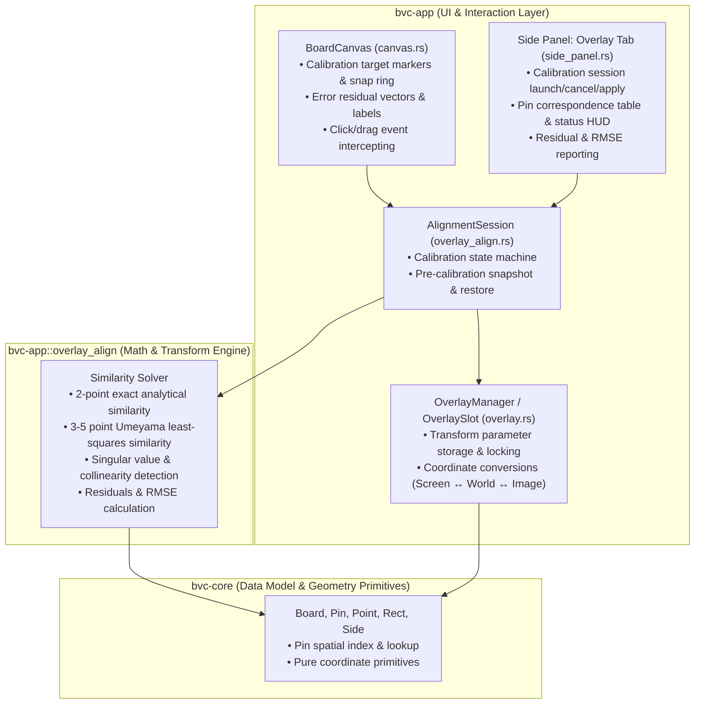

# Design: PCB Image Pin Alignment

## 1. Architectural Overview & Layer Boundaries

The PCB Image Pin Alignment capability provides an interactive, semi-automated calibration workflow. The user matches 2 to 5 reference pin locations on the CAD boardview layout with their corresponding physical pad locations on a high-resolution overlay photo. The system then computes an optimal 2D similarity transformation (scale $s$, rotation $\theta$, translation $t$) using exact analytical geometry (for 2 points) or least-squares estimation via the Umeyama algorithm (for 3 to 5 points), calculating per-pin residuals and Root Mean Square Error (RMSE).

### 1.1 Layer Boundaries & Crate Responsibilities



- **`bvc-core`**:
  - Provides immutable domain models: `Board`, `Pin`, `Part`, `Point`, `Rect`, and `Side`.
  - Provides spatial indexing (`Point::dist`, bounding box intersection).
  - Kept free of UI dependencies (`egui`) and specialized image calibration state.
- **`bvc-app::overlay_align`** (New Module):
  - Pure, deterministic mathematical routines and state machine.
  - Closed-form 2-point similarity calculation and 3–5 point Umeyama least-squares solver.
  - Numerical sanity checks (coincident points, collinear / rank-deficient matrices).
  - Residual Euclidean error and RMSE computation.
  - Session state machine (`AlignmentSession`, `AlignmentState`, `AlignmentPointPair`, `AlignmentResult`, `SolverError`).
- **`bvc-app::overlay`**:
  - `OverlaySlot` extension: helper methods to convert between board world mils, overlay local mils, and photo pixel coordinates $(u, v)$.
  - Direct application of `AlignmentResult` to update `slot.center`, `slot.zoom`, `slot.size`, `slot.fine_rotation_deg`, and lock baseline.
- **`bvc-app::canvas`**:
  - Intercepts clicks during calibration mode (`SelectingCadPin` and `SelectingPhotoPoint`).
  - Pin snapping mechanism: detects closest pin to cursor within snap radius (e.g. 25 pixels).
  - Visual overlays: numbered target crosshairs, photo marks, error vectors connecting CAD and transformed photo positions, and status HUD banner.
- **`bvc-app::side_panel`**:
  - Controls inside `Tab::Overlay`: correspondence table with per-pin residuals, re-pick / delete buttons, RMSE indicator, Apply / Cancel actions, and auto-lock checkbox.
- **`bvc-app::i18n`**:
  - Localized prompt strings and error messages for English, Spanish, and Catalan.

---

## 2. Mathematical Formulations

A 2D similarity transformation maps a point $P = (p_x, p_y)^T$ in photo coordinates into CAD board coordinates $C = (c_x, c_y)^T$:

$$C = s \cdot R(\theta) \cdot P + t$$

where:
- $s > 0$ is an isotropic scale factor.
- $R(\theta) = \begin{pmatrix} \cos\theta & -\sin\theta \\ \sin\theta & \cos\theta \end{pmatrix}$ is the 2D rotation matrix ($\det(R) = +1$).
- $t = \begin{pmatrix} t_x \\ t_y \end{pmatrix}$ is the 2D translation vector in board world mils.

### 2.1 Closed-Form 2-Point Similarity Transform (Exact Fit)

Given two CAD points $C_1, C_2$ and two corresponding photo points $P_1, P_2$:

1. **Displacement Vectors**:
   $$\vec{v}_C = C_2 - C_1 = \begin{pmatrix} c_{2x} - c_{1x} \\ c_{2y} - c_{1y} \end{pmatrix}$$
   $$\vec{v}_P = P_2 - P_1 = \begin{pmatrix} p_{2x} - p_{1x} \\ p_{2y} - p_{1y} \end{pmatrix}$$

2. **Distance & Degeneracy Check**:
   $$d_C = \|\vec{v}_C\| = \sqrt{(c_{2x} - c_{1x})^2 + (c_{2y} - c_{1y})^2}$$
   $$d_P = \|\vec{v}_P\| = \sqrt{(p_{2x} - p_{1x})^2 + (p_{2y} - p_{1y})^2}$$
   If $d_C < \epsilon$ or $d_P < \epsilon$ (with numerical tolerance $\epsilon = 10^{-4}$ mils), the points are coincident $\to$ return `SolverError::CoincidentPoints`.

3. **Scale Factor**:
   $$s = \frac{d_C}{d_P} = \frac{\|\vec{v}_C\|}{\|\vec{v}_P\|}$$

4. **Rotation Angle**:
   $$\theta_C = \text{atan2}(v_{Cy}, v_{Cx}), \quad \theta_P = \text{atan2}(v_{Py}, v_{Px})$$
   $$\theta = \theta_C - \theta_P$$
   Normalize $\theta$ to the range $[-\pi, \pi]$ (and convert to degrees in $[-180^\circ, 180^\circ]$).

5. **Translation Vector**:
   $$t = C_1 - s \cdot R(\theta) \cdot P_1$$

6. **Residual Verification**:
   For both points $i \in \{1, 2\}$, the residual $r_i = \|C_i - (s R(\theta) P_i + t)\| \equiv 0$ within floating point tolerance $\epsilon < 10^{-4}$.

---

### 2.2 Over-Determined 3-to-5 Point Umeyama Least-Squares Transform

For $N \ge 3$ pairs, the system minimizes the mean squared Euclidean distance error:

$$\min_{s, R, t} \frac{1}{N} \sum_{i=1}^N \|C_i - (s R P_i + t)\|^2$$

Following the Umeyama formulation:

1. **Centroids**:
   $$\mu_C = \frac{1}{N}\sum_{i=1}^N C_i, \quad \mu_P = \frac{1}{N}\sum_{i=1}^N P_i$$

2. **Centered Point Coordinates**:
   $$x_i = C_i - \mu_C, \quad y_i = P_i - \mu_P \quad \text{for } i = 1 \dots N$$

3. **Variance of Source Points ($P$)**:
   $$\sigma_P^2 = \frac{1}{N} \sum_{i=1}^N \|y_i\|^2 = \frac{1}{N} \sum_{i=1}^N (y_{ix}^2 + y_{iy}^2)$$
   If $\sigma_P^2 < \epsilon$ (or $\sigma_C^2 < \epsilon$), return `SolverError::CoincidentPoints`.

4. **Cross-Covariance Matrix $H$**:
   $$H = \frac{1}{N} \sum_{i=1}^N y_i x_i^T = \begin{pmatrix} H_{00} & H_{01} \\ H_{10} & H_{11} \end{pmatrix}$$
   where:
   $$H_{00} = \frac{1}{N} \sum_{i=1}^N y_{ix} x_{ix}, \quad H_{01} = \frac{1}{N} \sum_{i=1}^N y_{ix} x_{iy}$$
   $$H_{10} = \frac{1}{N} \sum_{i=1}^N y_{iy} x_{ix}, \quad H_{11} = \frac{1}{N} \sum_{i=1}^N y_{iy} x_{iy}$$

5. **Optimal 2D Rotation**:
   In 2D, the optimal rigid rotation angle $\theta$ maximizing $\text{tr}(R^T H)$ is computed analytically:
   $$\theta = \text{atan2}(H_{01} - H_{10}, H_{00} + H_{11})$$
   *Degeneracy / Collinearity Check*: If both $(H_{01} - H_{10})$ and $(H_{00} + H_{11})$ have magnitude $< \epsilon$, the configuration is completely degenerate (e.g. collinear points with isotropic collapse) $\to$ return `SolverError::CollinearPoints`.
   
   Construct $R = \begin{pmatrix} \cos\theta & -\sin\theta \\ \sin\theta & \cos\theta \end{pmatrix}$. Note that $\det(R) = +1$ ensures pure rotation without reflection.

6. **Optimal Isotropic Scale**:
   $$s = \frac{\text{tr}(R^T H)}{\sigma_P^2} = \frac{\cos\theta(H_{00} + H_{11}) + \sin\theta(H_{01} - H_{10})}{\sigma_P^2}$$
   If $s \le 0$ or not finite, return `SolverError::NumericalSingularity`.

7. **Optimal Translation Vector**:
   $$t = \mu_C - s \cdot R(\theta) \cdot \mu_P$$

---

### 2.3 Residuals and Root Mean Square Error (RMSE)

For each correspondence pair $i \in \{1 \dots N\}$:
- Projected photo point:
  $$\hat{C}_i = s \cdot R(\theta) \cdot P_i + t$$
- Individual Euclidean residual:
  $$r_i = \|C_i - \hat{C}_i\| = \sqrt{(c_{ix} - \hat{c}_{ix})^2 + (c_{iy} - \hat{c}_{iy})^2} \quad \text{[mils]}$$
- Overall Root Mean Square Error:
  $$\text{RMSE} = \sqrt{\frac{1}{N} \sum_{i=1}^N r_i^2} \quad \text{[mils]}$$
- Pixel residual reporting:
  $$r_{i, \text{px}} = \frac{r_i}{s \cdot \text{mil\_per\_pixel}}$$

Pins with residual $r_i > 1.5 \times \text{RMSE}$ and $r_i > 2.0\text{ mils}$ are flagged as potential outliers in the UI.

---

## 3. Data Structures

The core structures are defined in `crates/bvc-app/src/overlay_align.rs`:

```rust
use bvc_core::Point;
use thiserror::Error;

/// Error types occurring during calibration solving.
#[derive(Debug, Clone, PartialEq, Error)]
pub enum SolverError {
    #[error("At least 2 correspondence pairs are required to compute alignment (provided: {0})")]
    InsufficientPoints(usize),

    #[error("Maximum 5 correspondence pairs supported (provided: {0})")]
    ExcessPoints(usize),

    #[error("Reference points must be distinct; coincident points detected")]
    CoincidentPoints,

    #[error("Selected reference points are collinear; pick a point not along the line")]
    CollinearPoints,

    #[error("Numerical singularity encountered during transform calculation")]
    NumericalSingularity,
}

/// A correspondence between a boardview CAD pin and a photo coordinate.
#[derive(Debug, Clone, PartialEq)]
pub struct AlignmentPointPair {
    /// Index into Board.pins.
    pub pin_id: usize,
    /// Pin label (e.g. "1", "A1", "GND").
    pub pin_name: String,
    /// Part designator (e.g. "U1", "R10").
    pub part_name: String,
    /// CAD position in board world mils.
    pub cad_pos: Point,
    /// Photo position in board world mils (untransformed slot frame) or pixel space.
    pub photo_pos: Option<Point>,
}

/// Output of a successful similarity transformation solve.
#[derive(Debug, Clone, PartialEq)]
pub struct AlignmentResult {
    /// Optimal overlay slot center in board world mils.
    pub center: Point,
    /// Optimal isotropic zoom multiplier for OverlaySlot.
    pub zoom: f32,
    /// Optimal fine rotation angle in degrees [-180.0, 180.0].
    pub rotation_deg: f32,
    /// Root Mean Square Error in board world mils.
    pub rmse_mils: f32,
    /// Per-point Euclidean residuals in board world mils.
    pub residuals_mils: Vec<f32>,
}

/// Interactive state of the alignment session.
#[derive(Debug, Clone, PartialEq)]
pub enum AlignmentState {
    /// Idle, no alignment session active.
    Idle,
    /// Waiting for user to click a pin on the CAD layout.
    SelectingCadPin { pair_index: usize },
    /// Waiting for user to click corresponding pad on the photo overlay.
    SelectingPhotoPoint {
        pair_index: usize,
        pin_id: usize,
        part_name: String,
        pin_name: String,
        cad_pos: Point,
    },
    /// Alignment calculated and ready to preview or commit.
    ReadyToApply,
}

/// Snapshot of pre-calibration overlay parameters for safe rollback.
#[derive(Debug, Clone, Copy, PartialEq)]
pub struct OverlaySnapshot {
    pub center: Point,
    pub zoom: f32,
    pub size: egui::Vec2,
    pub fine_rotation_deg: f32,
    pub locked: bool,
}

/// Active alignment calibration session.
pub struct AlignmentSession {
    pub state: AlignmentState,
    pub pairs: Vec<AlignmentPointPair>,
    pub live_result: Option<Result<AlignmentResult, SolverError>>,
    pub snapshot: Option<OverlaySnapshot>,
    pub auto_lock_on_apply: bool,
    pub hovered_candidate_pin: Option<usize>,
}
```

---

## 4. UI & Canvas Integration

### 4.1 Coordinate Translations & Transform Mapping

The overlay image quad has three coordinate frames:
1. **Screen Pos (`egui::Pos2`)**: Window pixel coordinates.
2. **Board World Mils (`bvc_core::Point`)**: CAD coordinates in thousandths of an inch.
3. **Overlay Image Pixels / Normalized UVs**: Pixel coordinates $(u, v) \in [0, W] \times [0, H]$.

To mark points consistently regardless of overlay movement:
- When the user selects a CAD pin, its coordinate $C_i$ is directly known in board world mils from `pin.pos`.
- When the user clicks the photo on the canvas:
  1. The canvas receives screen coordinate $S = \text{response.hover\_pos()}$.
  2. Canvas converts $S$ to current board world mils $W$ via `viewport.screen_to_world(S, rect)`.
  3. The unaligned photo position is stored as $P_i$.
  
When the solver computes $s, R(\theta), t$:
- The transformation gives the mapping from initial photo world points $P$ to CAD board points $C$.
- The new `OverlaySlot` center becomes:
  $$C_{\text{center}} = s \cdot R(\theta) \cdot (\text{initial\_overlay\_center}) + t$$
- The new `OverlaySlot.zoom` becomes $\text{initial\_zoom} \times s$.
- The new `OverlaySlot.fine_rotation_deg` becomes $\text{normalize}(\text{initial\_rotation} + \theta_{\text{deg}})$.

### 4.2 Canvas Overlays & Visual Feedback

When `AlignmentSession` is active:
1. **CAD Pin Markers**:
   - Numbered circular badge (1 through 5) rendered at each $C_i$.
   - High-contrast circle (cyan stroke `#00E5FF`) with center crosshair.
   - Text badge with pin identifier (e.g. `1: U1.1`).
2. **Photo Target Markers**:
   - Numbered diamond or square badge (magenta `#FF4081`) rendered at $P_i$.
3. **Live Snap Ring**:
   - When in `SelectingCadPin` state, hovering within 25 screen pixels of any CAD pin draws an animated pulsing snap target ring around that pin.
4. **Error Residual Vectors**:
   - When $N \ge 2$ and a solution is computed, render a line segment from $C_i$ to the transformed photo position $\hat{C}_i$.
   - Color code:
     - Green ($r_i < 2.0$ mils)
     - Yellow ($2.0 \le r_i \le 5.0$ mils)
     - Red ($r_i > 5.0$ mils, outlier)
   - Beside each vector, display residual magnitude (e.g. `1.4 mil`).
5. **Floating Calibration HUD Banner**:
   - At the top of the canvas, render a non-intrusive floating guide frame:
     - `SelectingCadPin`: *"Step {i}/5: Click pin on CAD layout"*
     - `SelectingPhotoPoint`: *"Step {i}/5: Click corresponding pad on photo"*
     - `ReadyToApply`: *"Calibrated with {N} points. RMSE: {rmse} mils. Press Apply or Add More."*

### 4.3 Side Panel Workflow (`side_panel.rs`)

Inside `Tab::Overlay`:
- If no alignment is active:
  - Render `Align with Pins...` button (disabled if no overlay loaded).
- While alignment is active:
  - Header: *"Pin Calibration ({N}/5 pairs)"*
  - Table of pairs:
    - Column 1: `#`
    - Column 2: CAD Pin (`U1.1`)
    - Column 3: CAD pos $(x, y)$
    - Column 4: Photo pos $(x, y)$
    - Column 5: Residual error ($r_i$ in mils)
    - Column 6: Actions (`Re-pick`, `Delete`)
  - Summary metric: **RMSE: {rmse_mils:.2} mils**
  - "Add Pin Pair" button (active if $N < 5$).
  - Auto-lock checkbox: `[x] Auto-lock overlay after applying`.
  - Action row: `Apply Alignment` (primary green button) | `Reset` | `Cancel`.

---

## 5. Error Handling & Edge Cases

| Edge Case | Detection | User Feedback / System Behavior |
|-----------|-----------|----------------------------------|
| $< 2$ points picked | `pairs.len() < 2` | "Apply" disabled; status indicates "Pick at least 2 pin pairs". |
| $> 5$ points | `pairs.len() == 5` | "Add Pair" button disabled; info note "Maximum 5 calibration points reached". |
| Coincident CAD pins | $C_1 == C_2$ or $\|C_i - C_j\| < 10^{-4}$ | Banner alert: "Reference pins must be distinct". Apply disabled. |
| Coincident Photo marks | $P_1 == P_2$ or $\|P_i - P_j\| < 10^{-4}$ | Banner alert: "Photo marks are coincident; re-pick point". Apply disabled. |
| Collinear 3-5 points | $\text{rank}(H) < 2$ or zero determinant in Umeyama rotation | Warning: "Points are collinear; pick a reference pin outside this line". Fallback to 2-point solve across extreme endpoints with alert. |
| User presses `Escape` | Canvas key handler catches `Escape` | Immediately aborts session, restores original `OverlaySnapshot`, clears markers. |
| User switches tab or board | Session cleanup hook | Reverts preview transform and resets session to `Idle`. |
| Unsafe code & panics | Project standard | Zero `unwrap()` / `panic!()` in non-test code; `unsafe_code = "forbid"` enforced. All math uses checked arithmetic and returns `Result<AlignmentResult, SolverError>`. |

Path: `openspec/changes/pcb-image-pin-alignment/design.md`
